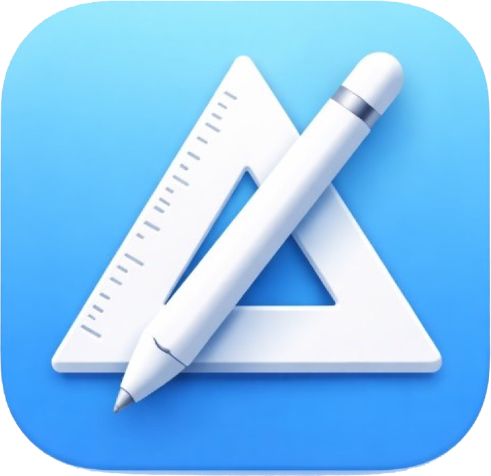

<p align="center">
  <a href="https://visucode.de/" title="VisuStruct">
    
  </a>
</p>

# VisuStruct (SwiftUI)

> **This repository is archived and no longer developed here.**
> VisuStruct, VisuBot, VisuObject and VisuFlow are now available at **[visucode.de](https://visucode.de)**.
> Hinweis: Dieses Repository wird hier nicht mehr weiterentwickelt. Alles Aktuelle findest du auf **[visucode.de](https://visucode.de)**.

Visual **Nassi–Shneiderman** structograms for **Mac, iPad, and iPhone**. Same **`.visustruct`** / XML as the open-source **[Java editor](https://github.com/code4teaching/VisuStruct)** — drag-and-drop.

**Localization:** The app ships a large set of UI translations (strings + Settings), with English and German treated as primary “source of truth” strings during development.

**Statements with I/O prefixes:** Instruction text can distinguish **statement / input / output** usage. Prefixes **`input:`** and **`print:`** are interpreted by the code generators (Java / JavaScript / Python targets) while keeping one shared diagram notation.

**[visucode.de](https://visucode.de)** · **Build & layout:** [VisuStruct-iOS/README.md](VisuStruct-iOS/README.md) · **Changes:** [CHANGELOG.md](CHANGELOG.md)

The **[Java VisuStruct](https://github.com/code4teaching/VisuStruct)** editor is based on [kekru/struktogrammeditor](https://github.com/kekru/struktogrammeditor) (MIT). **Sources and releases for Java** are maintained only in that repository (always current there). This **SwiftUI** app is a **reimplementation**: same **`.visustruct`** / XML as Java (and it opens legacy **`.strk`** files), not a port of that codebase.

---

## Clone

```bash
git clone https://github.com/code4teaching/VisuStruct-SwiftUI.git
```

**Remote:** [github.com/code4teaching/VisuStruct-SwiftUI](https://github.com/code4teaching/VisuStruct-SwiftUI)

## Web app and website

This repository contains only the SwiftUI app (iPad, iPhone, Mac). The web app (VisuStruct, VisuBot, VisuObject, VisuFlow), its lessons and the websites moved on 2026-11-05 to GitLab (`gitlab.lgsit.de/visucode/visustruct-web` and `visucode/website`) and are published on **[visucode.de](https://visucode.de)**.

## Changelog / release notes

Versioned release notes live in **[CHANGELOG.md](CHANGELOG.md)**. On the repository’s **GitHub home page**, only this **README** is shown in full by default; open `CHANGELOG.md` in the file list (or use the **Changes** link at the top) to read the history. The **Releases** tab only shows extra notes if you create [GitHub Releases](https://github.com/code4teaching/VisuStruct-SwiftUI/releases) (optional, in addition to the changelog file).

## License

VisuStruct is open source under the **[MIT License](LICENSE)**. Third-party parts keep their own licenses (e.g. CodeMirror: MIT). The optional Swing support in the web app loads [CheerpJ](https://cheerpj.com) by Leaning Technologies from its CDN at runtime (Community License, not part of this repository).
