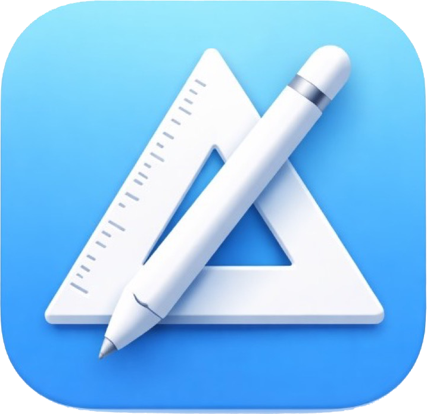

<p align="center">
  <a href="https://visustruct.org/" title="VisuStruct">
    
  </a>
</p>

# VisuStruct — SwiftUI (iPad & Mac)

SwiftUI app plus **`VisuStructCore`** (model, layout, XML import/export). **`.visustruct`** matches the **[Java VisuStruct](https://github.com/code4teaching/VisuStruct)**.

**[visustruct.org](https://visustruct.org)**

| Path | Role |
|------|------|
| **`VisuStructCore/`** | Swift package — develop here; `swift build`. |
| **`VisuStructXcodeOpen/`** | Xcode project `VisuStruct.xcodeproj` (local package `../VisuStructCore`). |

## Build (Xcode)

1. Open `VisuStructXcodeOpen/VisuStruct.xcodeproj`
2. Select scheme **VisuStruct** → run on a simulator or device.

## Build (package only)

```bash
cd VisuStructCore
swift build
```

## File format (Java VisuStruct)

The open-source **[Java / Swing editor](https://github.com/code4teaching/VisuStruct)** is developed and released only there — that repo is the **authoritative**, up-to-date Java edition. This SwiftUI monorepo does not ship Java sources; `VisuStructCore` keeps **element types** and **XML** compatible with that app.

### Element types (`typ`)

0 `anweisung` · 1 `verzweigung` · 2 `fallauswahl` · 3 `forSchleife` · 4 `whileSchleife` · 5 `doUntilSchleife` · 6 `endlosschleife` · 7 `aussprung` · 8 `aufruf` · 9 `leerElement`

### XML (sketch)

- Root: `<struktogramm fontfamily="…" fontsize="…" fontstyle="…" caption="…">`
- Children: `<strelem typ="…" …>` with `<text>`, optional `<schleifeninhalt>`, `<fall fallname="…">`
- Strings: `VisuStructJavaStringCoding` (Java-compatible).

## Features (current)

- Tabs, palette, **drag & drop**, text inspector, undo/redo  
- Open / save **`.visustruct`**, share **PNG**, **print** where supported  
- Broad **multi-language UI** coverage via **`Localizable.strings`** + **`Settings.bundle`** (English/German maintained as authoring sources; additional locales ship as translations).
- **Clipboard actions** for diagram blocks (copy/cut/paste) plus keyboard/menu shortcuts where the platform supports first-class editing commands.
- **Instruction modes** with uniform prefixes across languages:
  - **`print:`** maps to appropriate output APIs per generator target.
  - **`input:`** maps to appropriate input/prompt APIs per generator target.
- **JavaScript runner** uses `WKWebView` with UI delegate hooks so **`prompt()`** works during interactive runs.
- **Code generator:** on **iPad & Mac**, a **draggable panel** over the diagram (sheet on **iPhone**); Java / Python / JavaScript output, copy, Java export, in-app JS runner.
- **Typography:** separate **UI scale** for **canvas** vs **inspector** (see Settings).

## Differences vs Java UI

- Canvas look is mostly fixed; document font / tile colors from XML are not yet fully matched visually (data round-trips).  
- `VisuStructEditError`, `VisuStructXMLError`, and simulation errors use **English** messages (not localized per app UI language).

## Release notes

See repository root **[CHANGELOG.md](../CHANGELOG.md)** for versioned highlights (e.g. **1.2.1**, **1.2**).
